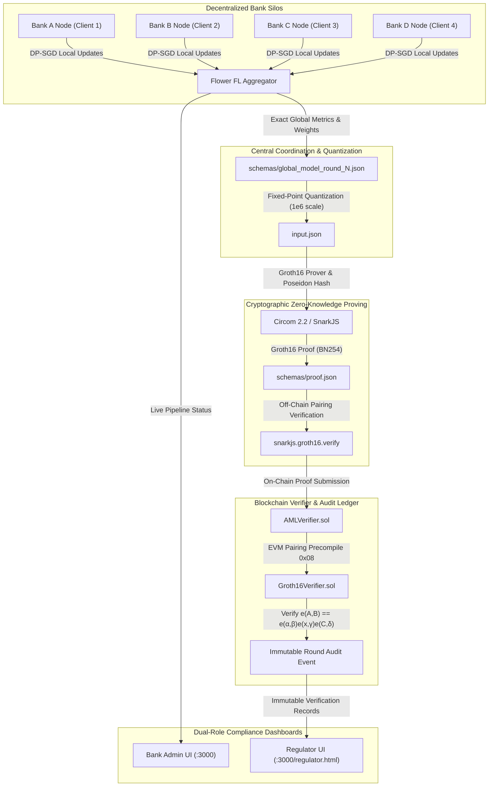

# Verifiable Federated Intelligence (VFI)

> **Decentralized, Privacy-Preserving Anti-Money Laundering (AML) Intelligence with Zero-Knowledge Proofs & On-Chain Auditability.**

[](docs/TEST_RESULTS.md)
[](LICENSE)
[](zkp/circuit/aml_verify.circom)
[-success.svg)](fl_implementation/client.py)

---

## 📐 System Architecture



---

## ⚡ Quickstart Guide

### 1. Prerequisites
- **Python:** `3.10` – `3.13` (with PyTorch, Flower, scikit-learn, imbalanced-learn, networkx)
- **Node.js:** `^18.0` – `^25.0`
- **Circom:** `2.2.x` & **SnarkJS:** `0.7.x`
- **Hardhat:** `2.22.x`

### 2. Environment Setup
```bash
# Clone the repository
git clone https://github.com/Keeru-2005/Verifiable-Federated-Intelligence.git
cd Verifiable-Federated-Intelligence

# Install Python dependencies
pip install -r requirements.txt

# Install Root Node dependencies (SnarkJS, Circomlib, Ethers, Dotenv)
npm install

# Install Blockchain dependencies
cd blockchain && npm install && cd ..

# Install Dashboard dependencies
cd dashboard && npm install && cd ..
```

---

## 🧪 Automated Testing

The repository contains 34 comprehensive automated tests covering data preprocessing, model training, federated learning, zero-knowledge proofs, smart contracts, backend APIs, and end-to-end integration:

```bash
# Run ALL 34 tests in a single command
npm test

# Run individual test suites:
npm run test:python      # Pytest: Preprocessing, Model/FL, ZKP, & E2E Pipeline (21 tests)
npm run test:contracts   # Hardhat: Groth16 EVM Pairing & AMLVerifier tests (7 tests)
npm run test:api         # Node.js: Backend Express API & Concurrency tests (6 tests)
```

See [docs/TEST_RESULTS.md](docs/TEST_RESULTS.md) for full benchmark timings and test details.

---

## 🚀 Live Capstone Demonstration

### Option A: Complete Interactive Milestone Demo (Recommended)
Runs through all 10 stages of the pipeline with real-time logging, live proof generation, off-chain pairing check, and on-chain verification:
```bash
npm run demo
```

### Option B: Single-Command End-to-End Pipeline Orchestration
Executes data preprocessing, Flower federated learning, weight quantization, Groth16 proof generation, and smart contract submission:
```bash
# Fast mode for testing/demo (sample dataset)
node orchestrate.js --quick

# Full production mode (all 1.09M transactions across 10 rounds)
node orchestrate.js
```

### Option C: Live Dual-Role Web Dashboards
Start the local dashboard server:
```bash
npm run dashboard
```
Then navigate to:
- **Bank Admin Dashboard:** `http://localhost:3000` (Federated model metrics, baseline comparisons, node telemetry).
- **Regulator Audit Dashboard:** `http://localhost:3000/regulator.html` (Cryptographic verification status, weight commitments, on-chain ledger records).

---

## 🔐 Privacy & Cryptographic Guarantees

1. **Differential Privacy (DP-SGD):**
   - Implemented in `fl_implementation/client.py`.
   - Gradient norm clipping: $C = 1.0$.
   - Calibrated Gaussian noise addition: $\sigma = 0.5$.
   - Analytical privacy budget: $(\epsilon = 3.84, \delta = 10^{-5})$.
   - Raw customer transaction records remain strictly local within bank data silos.

2. **Zero-Knowledge Proofs (Groth16):**
   - Circuit: `zkp/circuit/aml_verify.circom` (30,229 R1CS constraints).
   - Cryptographic commitment: Poseidon Hash over parameter matrices.
   - Proof protocol: Groth16 over the BN254 / alt_bn128 curve.
   - Public signals enforce the sample-count-weighted aggregation relation.
   - Off-chain pairing verification via `zkp/verify_proof.js` / SnarkJS (~0.08 s).

3. **Smart Contract Auditability:**
   - Contracts: `blockchain/contracts/AMLVerifier.sol` & `blockchain/contracts/Groth16Verifier.sol`.
   - True cryptographic EVM verification: Invokes precompile `0x08` (`ecPairing`).
   - G2 points are mapped with coordinate swap for EVM big-endian alignment.
   - Immutable on-chain records: Round index, model weights hash, accuracy, F1-score, and submitter address.

---

## 📁 Repository Structure

```
Verifiable-Federated-Intelligence/
├── blockchain/                   # Smart contracts & Hardhat development environment
│   ├── contracts/
│   │   ├── AMLVerifier.sol       # AML audit registry contract
│   │   └── Groth16Verifier.sol   # Autogenerated BN254 Groth16 pairing verifier
│   ├── scripts/                  # Deploy & proof submission scripts
│   └── test/                     # Hardhat unit tests (7 tests)
├── dashboard/                    # Real-time web dashboards & Express API
│   ├── server.js                 # API server (live RPC, model metrics, logs)
│   ├── index.html                # Bank Admin control panel
│   └── regulator.html            # Regulatory compliance audit ledger
├── data/                         # AML dataset & preprocessing scripts
│   ├── amlnet.csv                # Primary transaction dataset
│   └── preprocess.py             # Leak-free train/test split, PCA, SMOTE
├── demo/                         # Demonstration scripts
│   └── run_demo.js               # Clean 10-stage live demo runner
├── fl_implementation/            # Flower Federated Learning subsystem
│   ├── server.py                 # FL server with exact confusion-matrix aggregation
│   ├── client.py                 # Bank client with DP-SGD (clipping + Gaussian noise)
│   ├── split_into_banks.py       # Decentralized 4-bank partitioner
│   └── extract_client_weights.py # Parameter extractor & exporter
├── models/                       # PyTorch neural network architectures
│   └── mlp.py                    # GraphAwareMLP binary classifier
├── schemas/                      # Dynamic JSON artifacts (rounds, metrics, proof.json)
├── tests/                        # Automated test suites (Pytest & Node)
│   ├── test_data_preprocessing.py
│   ├── test_model_fl.py
│   ├── test_zk_snark.py
│   ├── test_e2e_pipeline.py
│   └── test_backend_api.js
├── zkp/                          # Zero-Knowledge Proof subsystem
│   ├── circuit/
│   │   ├── aml_verify.circom     # Circom R1CS aggregation verification circuit
│   │   ├── aml_verify_final.zkey # Proving key
│   │   └── verification_key.json # Verification key
│   ├── generate_proof.js         # SnarkJS Groth16 fullProve runner
│   └── verify_proof.js           # SnarkJS pairing verifier
├── coordinate.js                 # Master pipeline coordinator
├── orchestrate.js                # Single-command pipeline executor
└── package.json                  # Unified test and execution scripts
```

---

## 🏆 Model Performance Summary

- **Dataset:** AMLNet Bipartite Transaction Dataset (1,081,635 transactions).
- **Architecture:** PyTorch `GraphAwareMLP` (32 PCA features + Graph Topological embeddings).
- **Federated Quorum:** 4 Decentralized Bank Nodes (Flower `flwr`).
- **Holdout Test Set Accuracy:** **99.67%**
- **Holdout Test Set F1-Score:** **0.9967**
- **Holdout Test Set Recall:** **99.87%** (High true-positive catch rate on illicit money flows).
